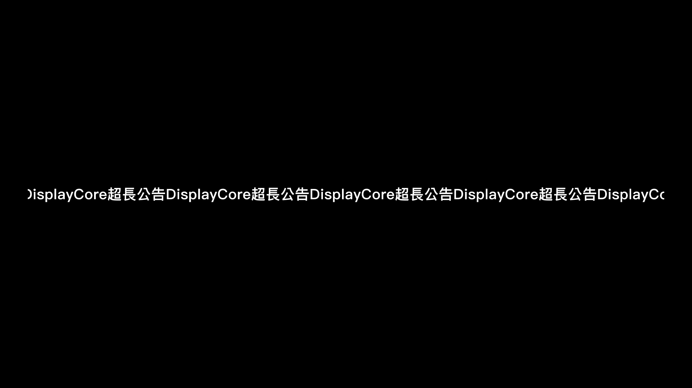

# QA Report: DisplayCore

| 欄位 | 結果 |
|---|---|
| 日期 | 2026-07-17 |
| 目標 | `displaycore://app/control/index.html`、`displaycore://app/display/index.html` |
| 分支 | `main` |
| Commit | `495a6df78176fc130f0506204021aab7a81fd565` |
| PR | — |
| QA 等級 | Exhaustive |
| 範圍 | 完整離線 Electron 應用程式、Renderer、Main、IPC、設定、顯示排版、封裝與安全邊界 |
| 測試主機 | macOS 26.4.1、Apple M1、arm64、單一 1440×900 Retina 螢幕 |
| 測試時間 | 完整多階段執行；未精確計時 |
| Renderer 頁面／狀態 | 2 個頁面、至少 12 種狀態 |
| 截圖 | 16 張 |
| 技術 | Electron 43.1.1、Node.js 24.18.0、HTML／CSS／ES Modules |

> 結論：本輪未發現 Critical／High，軟體 QA gate 通過；已修正三項問題並加入回歸測試，另有三項產品規則／上游項目 deferred。目前可進入 Windows 實機驗收，但最終上線仍受 ISSUE-003／004 的產品決策，以及 Windows 10／11 與 HDMI 電視實機驗收阻擋。

## Health Score：97/100

初始檢查為 93/100；修正 ISSUE-001、ISSUE-002 與 QA 產物整合時發現的 ISSUE-006 後為 97/100。

| 分類 | 初始 | 最終 |
|---|---:|---:|
| Console | 100 | 100 |
| Links | 100 | 100 |
| Visual | 100 | 100 |
| Functional | 76 | 92 |
| UX | 100 | 100 |
| Performance | 100 | 100 |
| Content | 100 | 100 |
| Accessibility | 84 | 92 |

Visual 分數只評估 standard-motion 下的響應式幾何、裁切、重疊與版面一致性；reduced-motion 的超長文字可讀性另計入 Accessibility。

## 上線前的三項阻擋

1. **ISSUE-003：超長跑馬燈與固定翻頁秒數衝突** — 需決定每頁秒數是否改為「最短停留時間」，並讓跑馬燈頁至少完成一次後才翻頁。
2. **ISSUE-004：減少動態效果時的超長文字不可讀** — 需決定無人 Display 是否仍強制跑馬燈，或在 Control 阻擋無法靜態完整顯示的內容。
3. **Windows／HDMI 實機驗收** — 必須在 Windows 10、Windows 11、實體 HDMI 電視與混合 DPI 環境完成；本次 macOS 主機無法代替該驗收。

## Console Health

- Control 與 Display Renderer 在完整互動及五種解析度測試中均為 **0 errors、0 warnings**。
- macOS 封裝版 Main Process 啟動時有 1 筆 Node `DEP0180` warning。追蹤指向 Electron 內部 ASAR `asarStatsToFsStats`，應用程式仍正常啟動；列為 ISSUE-005，不以 Renderer error 扣分。
- CSP、導覽、Popup、權限、下載與網路封鎖測試沒有發現錯誤或外部連線。

## Summary

| 嚴重度 | 發現 | 已修正 | 尚待決定／追蹤 |
|---|---:|---:|---:|
| Critical | 0 | 0 | 0 |
| High | 0 | 0 | 0 |
| Medium | 5 | 3 | 2 |
| Low | 1 | 0 | 1 |
| **總計** | **6** | **3** | **3** |

## Issues

### ISSUE-001：設定對話框偶爾恢復到錯誤入口

| 欄位 | 結果 |
|---|---|
| Severity | Medium |
| Category | Accessibility |
| 位置 | Control Window／系統設定與輸出設定對話框 |
| Fix Status | Verified |
| Commit | `6b81cd5` |

**現象：** 從「管理輸出設定」開啟並關閉對話框時，原生 `<dialog>` 可能先把焦點還給舊的「開啟系統設定」按鈕；延遲送達的 `close` handler 也可能在使用者開始下一個操作後搶走焦點。舊版在同一個 Control smoke 單程序重複啟動 harness 中為 42/43 通過，且確定性 fixture 能重現錯誤焦點。

**預期：** 關閉後立即恢復到實際開啟對話框的按鈕；之後使用者移動到其他控制項時，延遲事件不得再搶走焦點。

**修正：** 在 `dialog.close()` 返回後立即聚焦實際 trigger；`close` 事件只處理排隊重開，不再延遲恢復焦點；Escape 也統一走相同關閉流程。

**驗證：** 新增真實 Electron regression fixture，同時驗證 `manage-output-settings-button` 的立即恢復與 `next-action-input` 的後續焦點保留。正式單一 DisplayCore App 執行 90/90（輸出入口、一般入口及 CPU 壓力各 30 次），立即、microtask 與 settled 三個觀察點均正確；關閉後的新 recipient focus 100/100 保留，隔離 Control 另為 20/20。額外同時啟動多個 Electron 程序的非正式 OS 焦點壓力為背景 App 9/10、四路平行 37/40；部分失敗同時出現 macOS `task_policy` 訊息，且都處於程序間競爭 OS focus 的非正式條件，不是正式單一執行個體驗收結果。

### ISSUE-002：封裝規則未排除無點號的 `ait/` 目錄

| 欄位 | 結果 |
|---|---|
| Severity | Medium |
| Category | Functional |
| 位置 | Electron Forge packager ignore 規則 |
| Fix Status | Verified |
| Commit | `40a75e3` |

**現象：** 原規則可排除 `.ait/` 與 `*.ait`，但不會排除根目錄或巢狀的普通 `ait/` 目錄。若這類資料重新出現在專案或資產中，可能被帶入封裝。

**預期：** `.ait/`、`ait/`、巢狀 `ait/` 與 `*.ait` 全部排除；名稱只是包含字串的 `wait/` 不可誤排除。

**修正與驗證：** ignore pattern 改為同時接受可選的點號；先加入會失敗的測試，再確認 `/ait/settings.json`、`/assets/ait/config.json` 被排除，`/assets/wait/config.json` 保留。macOS 與 Windows x64 的 `app.asar` 實際清單均未包含 `.ait`、`ait` 或 `*.ait`。

### ISSUE-003：超長跑馬燈無法在固定翻頁前完成一次 traversal

| 欄位 | 結果 |
|---|---|
| Severity | Medium |
| Category | Functional |
| 位置 | Display Window／多頁播放 |
| Fix Status | Deferred — 等待產品規則確認 |

**現象：** Main Process 依使用者設定的 `pageDurationSeconds` 排程翻頁，Display 依實際文字寬度計算跑馬燈動畫時間。單頁 continuous 狀態下，以約 6,300 個字元、1920×1080 實測的完整一輪動畫約需 1,941 秒；依已驗證的頁面排程機制可判定，若每頁設定為 3 秒，有限／多頁模式會在完成一次 traversal 前離開該頁。該內容仍低於系統合計 10,000 Unicode code point 的合法上限。本輪沒有等待 1,941 秒錄製完整動畫或另外擷取多頁翻頁影片，因此此結論是「實際動畫量測＋已驗證排程機制」的推論。

**影響：** 「不得截斷、完整顯示」與「固定每頁秒數」對超長內容無法同時成立。

**建議：** 將使用者設定的每頁秒數定義為最短停留時間；需要跑馬燈的頁面自動延長到所有列至少完成一次，Control 同時顯示實際估計時間。此變更會讓整輪時間比原先試算更長，必須先取得產品決定。

截圖只代表動畫中的單一影格；左右 viewport mask 是預期的跑馬燈裁切效果，不是完整 traversal 的證據。

### ISSUE-004：`prefers-reduced-motion` 下的超長靜態文字不可讀

| 欄位 | 結果 |
|---|---|
| Severity | Medium |
| Category | Accessibility |
| 位置 | Display Window／減少動態效果模式 |
| Fix Status | Deferred — 等待產品規則確認 |

**現象：** Renderer 透過 `matchMedia('(prefers-reduced-motion: reduce)')` 判定減少動態效果後，不建立 marquee DOM，改走單行 `scaleX` 壓縮；CSS media rule 另提供停止動畫的防線。為遵守單行與不截斷規則，約 6,300 個字元時縮放接近 1%，在 1920×1080 Renderer 截圖中已近似細線且視覺上不可辨讀；實體電視觀看距離尚未驗收。本輪以 CDP `Emulation.setEmulatedMedia` 在真實 Electron Renderer 模擬該偏好，尚未在 Windows 作業系統的輔助設定中實際切換驗證。

**建議選項：** 無人 Display Window 強制允許跑馬燈、只讓 Control 尊重 reduced-motion；或在送出前拒絕無法以靜態單行清楚呈現的內容。兩者的產品行為不同，不能在 QA 階段代替使用者決定。

### ISSUE-005：封裝版 Main Process 顯示 Electron ASAR deprecation warning

| 欄位 | 結果 |
|---|---|
| Severity | Low |
| Category | Console |
| 位置 | macOS packaged app startup |
| Fix Status | Deferred — 追蹤 Electron 上游 |

**現象：** 封裝版啟動會顯示 `[DEP0180] fs.Stats constructor is deprecated`。`--trace-deprecation` 指向 Electron 內部 ASAR 轉換層，不是 Renderer 或 DisplayCore 直接建構 `fs.Stats`。

**處理：** 保留目前安全的 ASAR 與本機協定驗證，不以降低封裝安全性來隱藏 warning。應在後續 Electron 升級時重測。

### ISSUE-006：QA 報告原本會被帶入應用程式封裝

| 欄位 | 結果 |
|---|---|
| Severity | Medium |
| Category | Functional |
| 位置 | Electron Forge packager ignore 規則 |
| Fix Status | Verified |
| Commit | `495a6df` |

**現象：** 第 10 步將報告與截圖存入專案 `.gstack/` 後，原 Forge ignore 規則不會排除該目錄；若直接重新封裝，約 1.5 MiB 的 QA 截圖、主機資訊與測試報告會進入 `app.asar`。

**修正與驗證：** 先新增 `/.gstack/qa-reports/baseline.json` 應被排除的失敗測試，再加入根目錄 `.gstack/` ignore 規則。最後使用包含 README 與 QA 報告的工作樹重建 macOS／Windows x64 封裝，實際檢查兩份 ASAR 均沒有 `.gstack`、QA 報告或截圖。

## Fixes Applied

| Issue | 狀態 | Commit | 變更檔案 |
|---|---|---|---|
| ISSUE-001 | verified | `6b81cd5` | `control/settings-view.mjs`、`tests/fixtures/control-settings-focus/index.html`、`tests/integration/control-settings-focus.regression-1.test.js` |
| ISSUE-002 | verified | `40a75e3` | `forge.config.js`、`tests/unit/project-scaffold.test.js` |
| ISSUE-003 | deferred | — | 等待每頁時間／跑馬燈規則決定 |
| ISSUE-004 | deferred | — | 等待無人 Display 的 reduced-motion 規則決定 |
| ISSUE-005 | deferred | — | 等待 Electron 上游版本重測 |
| ISSUE-006 | verified | `495a6df` | `forge.config.js`、`tests/unit/project-scaffold.test.js` |

## Regression Tests

| Issue | 測試 | 結果 | 說明 |
|---|---|---|---|
| ISSUE-001 | `tests/integration/control-settings-focus.regression-1.test.js` | committed／pass | 真實 Electron `<dialog>` 焦點恢復與延遲事件不搶焦點 |
| ISSUE-002 | `tests/unit/project-scaffold.test.js` | committed／pass | `.ait`、`ait`、巢狀目錄與 `wait` 負例 |
| ISSUE-003 | 真實 Display 長字串視覺檢查 | deferred | 規則尚未決定，不能先寫入錯誤期待值 |
| ISSUE-004 | 真實 Display reduced-motion 截圖 | deferred | 規則尚未決定 |
| ISSUE-006 | `tests/unit/project-scaffold.test.js` | committed／pass | 專案根目錄 `.gstack/` 不得進入封裝 |

## 自動化與執行結果

| 項目 | 結果 |
|---|---|
| Node 24.18.0 完整測試 | 245/245 pass |
| Host Node 完整測試 | 245/245 pass |
| Node 24 coverage | Lines 94.82%、Branches 88.44%～88.45%、Functions 92.69%；相同指令重跑時 branch 結果因並行執行次序有 0.01% 浮動 |
| 骨架 smoke | pass |
| Main 雙視窗 smoke | pass |
| Control＋Display 真實 Renderer smoke | 2/2 pass，0 console errors/warnings |
| 排程／臨檢／IPC／拓樸壓力 | 112 個既有 testcase 各重複 31 輪，共 3,472 次 testcase executions，全部通過；不是 3,472 種獨立情境 |
| 五種目標解析度 | Electron smoke 以 `BrowserWindow.setContentSize` 驗證原生 viewport，截圖以 CDP device metrics 產生；1366×768、1600×900、1920×1080、2560×1440、3840×2160 全部通過，但不等同五台實體螢幕驗收 |
| 7 則分頁 | 第 1 頁 5 則、第 2 頁 2 則；無換行、裁切、重疊或溢位 |
| 555／888 | 各 24 格、6×4 滿屏、黑底白字、assertive 狀態通過 |
| `npm audit` | dependencies 與含 devDependencies 均 0 vulnerabilities |
| registry signatures | 485 verified signatures、43 attestations |
| macOS 封裝 | package pass、`codesign --verify --deep --strict` pass、packaged smoke pass |
| Windows x64 交叉封裝 | package pass；產出 PE32+ x86-64 GUI executable，未在 macOS 執行 |
| 啟動效能 | macOS packaged app 5/5；0.51～0.52 秒 |
| Electron fuses | 兩平台封裝皆啟用 ASAR integrity、OnlyLoadAppFromAsar、CookieEncryption；RunAsNode、NODE_OPTIONS、CLI inspect 關閉 |
| AIT 封裝檢查 | macOS／Windows ASAR 均無 `.ait`、`ait`、`*.ait` |

Windows x64 交叉封裝雜湊：

- `DisplayCore.exe`: `73b383ccd997ad465b0e1d7382e46ddc138ea2a86795c3be71a60a81df508840`
- `resources/app.asar`: `7eccc9eb27077c9066af9f4d302504415d9608d77b0263288737d667de7e9038`

## 視覺證據

- [Control 初始畫面](screenshots/control-initial-1366x768.png)
- [Control 7 則待播清單](screenshots/control-queue-7-1366x768.png)
- [Control 555 確認](screenshots/control-emergency-555-dialog-1366x768.png)
- [Control 輸出設定桌面版](screenshots/control-output-settings-1366x768.png)
- [Control 輸出設定 375×812](screenshots/control-output-settings-375x812.png)
- [Display 空白狀態](screenshots/display-blank-1366x768.png)
- [Display 第 1 頁 1366×768](screenshots/display-page1-1366x768.png)
- [Display 第 1 頁 1600×900](screenshots/display-page1-1600x900.png)
- [Display 第 1 頁 1920×1080](screenshots/display-page1-1920x1080.png)
- [Display 第 1 頁 2560×1440](screenshots/display-page1-2560x1440.png)
- [Display 第 1 頁 3840×2160](screenshots/display-page1-3840x2160.png)
- [Display 第 2 頁](screenshots/display-page2-1920x1080.png)
- [Display 跑馬燈](screenshots/display-marquee-1920x1080.png)
- [Display reduced-motion 壓縮](screenshots/display-reduced-motion-compressed-1920x1080.png)
- [Display 555](screenshots/display-emergency-555-1920x1080.png)
- [Display 888](screenshots/display-emergency-888-1920x1080.png)

截圖建立於非視覺修正前的 `04310b8`；其後三項修正只涉及焦點時序與封裝排除規則，顯示畫面未變更，並已以完整測試重新驗證。

## Windows／HDMI 實機驗收清單

下列項目因本次主機不是 Windows、沒有第二螢幕也沒有 HDMI，尚未執行：

- Windows 10 與 Windows 11 各自冷啟動、重開機、長時間持續播放。
- HDMI 電視插入、拔除、關機、重新開機及同一 Display ID 恢復。
- 電視為 Windows 主螢幕、內建螢幕為主螢幕、只有單一螢幕等組合。
- 負座標、上下排列、左右排列與 100%／125%／150% 混合 DPI。
- 五種目標解析度在實體輸出上的全螢幕、置頂、不可操作與視窗模式位置。
- 睡眠／喚醒、鎖定／解鎖、顯示卡重新枚舉。
- WMI HDMI 回報 connected／disconnected／unknown，以及企業政策阻擋 PowerShell 時的安全降級。
- Squirrel.Windows 安裝、解除安裝、升級與安裝後啟動；`npm run make` 應在 Windows 主機執行。

## Ship Readiness

| 指標 | 結果 |
|---|---|
| Health score | 93 → 97（+4） |
| Issues found | 6 |
| Fixes applied | 3（verified: 3、best-effort: 0、reverted: 0） |
| Deferred | 3 個產品／上游項目；另有 Windows 實機驗收環境邊界 |
| 判定 | 未發現 Critical／High，軟體 QA gate 通過；最終上線仍受 ISSUE-003／004 產品決策與 Windows／HDMI 實機驗收阻擋 |

**PR Summary:** “QA found 6 issues, fixed 3, health score 93 → 97; marquee/reduced-motion decisions and Windows/HDMI hardware acceptance remain.”
